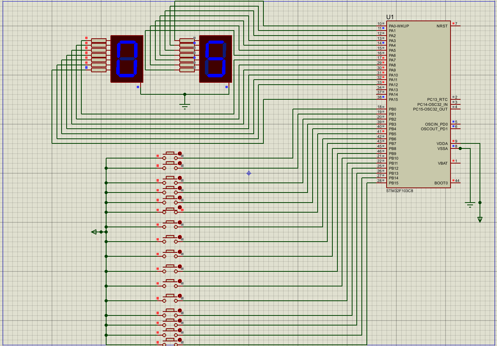
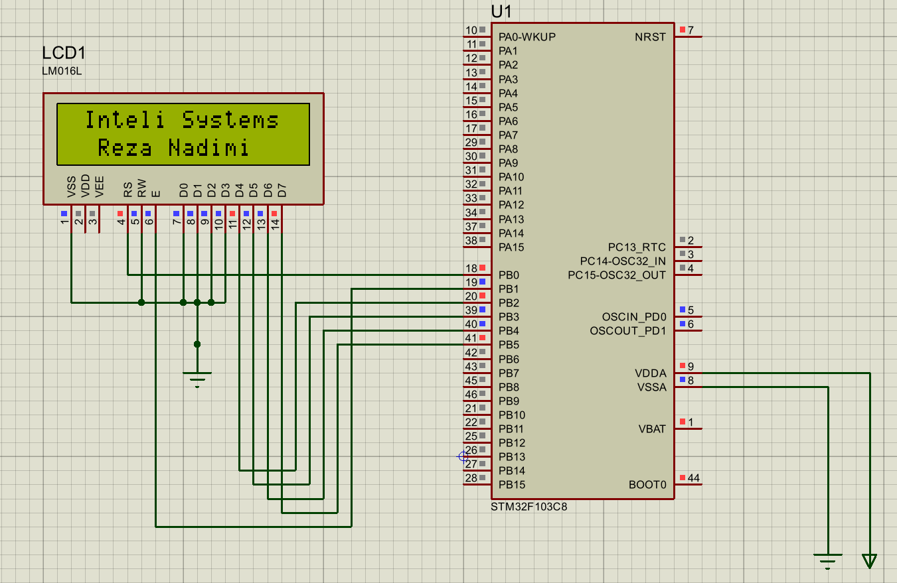
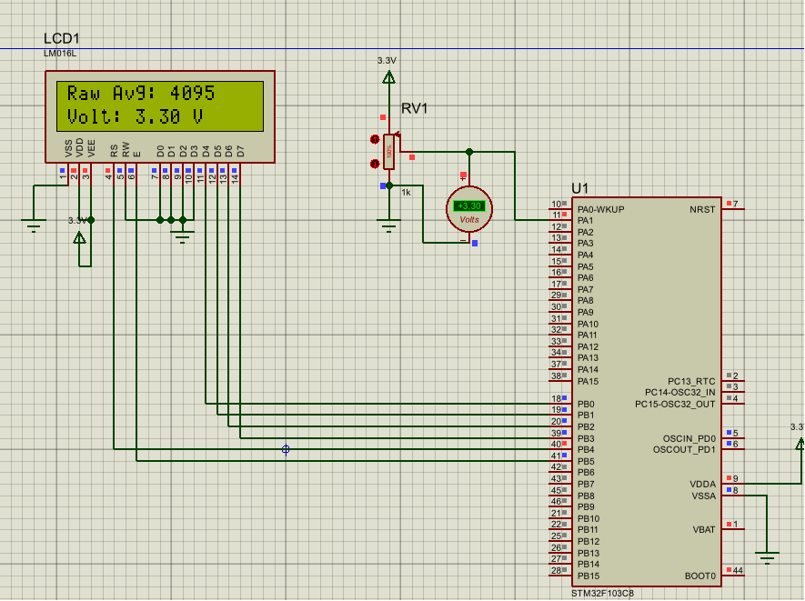
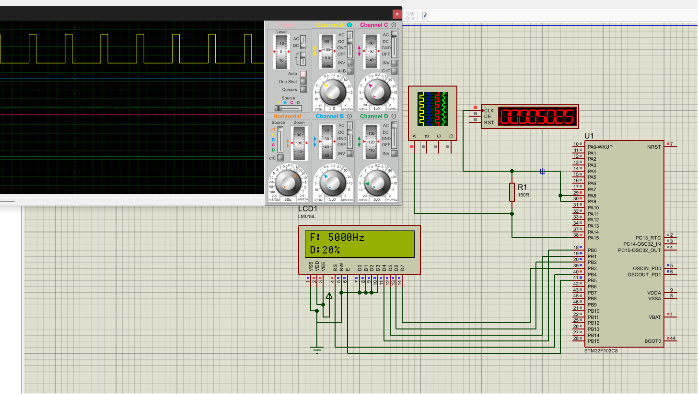
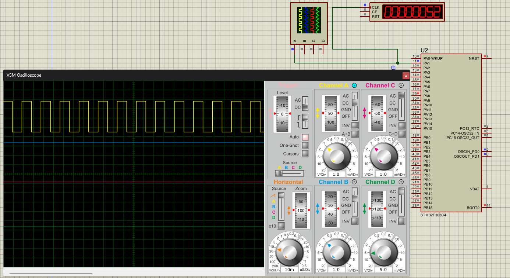
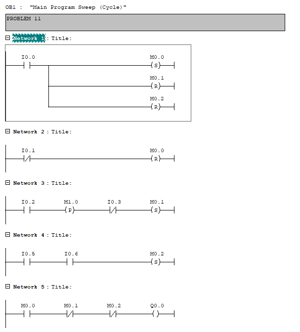

# STM32_PLC_MECH2_embedded

[](https://creativecommons.org/licenses/by/4.0/)


STM32 (STM32F103 / STM32F1xx HAL) + Proteus + Siemens PLC coursework — **Mechatronics 2 (Mech2)**, University of Tehran.

By **Reza Nadimi**. Course instructor: **Dr. Bahram Tarverdizadeh**. The exercise statements are the instructor's; the solutions (code, simulations, schematics, reports) are my own work. Each homework folder holds CubeMX/Keil firmware (`Core/`, `.ioc`), Proteus simulation (`.pdsprj`), screenshots/videos, and a `Reza_Nadimi_Mech2_HW*.docx/.pdf` report.

---

## 📸 Project Gallery

<table>
  <tr>
    <td align="center" width="50%">
      <br>
      <b>HW1</b> – GPIO: two 7-segment displays and a push-button bank
    </td>
    <td align="center" width="50%">
      <br>
      <b>HW2</b> – 16x2 LCD in 4-bit mode, centered text
    </td>
  </tr>
  <tr>
    <td align="center">
      <br>
      <b>HW3</b> – EXTI: lead/follow encoder signals, revolutions, direction and counter on the LCD
    </td>
    <td align="center">
      <br>
      <b>HW4</b> – USART1 (9600 8N1) with virtual COM port and LCD (DMA variant)
    </td>
  </tr>
  <tr>
    <td align="center">
      <br>
      <b>HW5</b> – ADC: potentiometer input, 50-sample average, volts on the LCD
    </td>
    <td align="center">
      <br>
      <b>HW6</b> – TIM2 PWM: frequency and duty cycle shown on LCD, verified on the oscilloscope
    </td>
  </tr>
  <tr>
    <td align="center">
      <br>
      <b>HW7</b> – Timer output compare / interrupts with oscilloscope and counter
    </td>
    <td align="center">
      <br>
      <b>HW8</b> – Siemens STEP 7 ladder logic (Problem 11)
    </td>
  </tr>
</table>

---

## Hardware / Software

| Item | Details |
|---|---|
| MCU | STM32F103 (STM32F1xx HAL, HSI clock) — see `*.ioc` |
| IDE | Keil MDK-ARM (`MDK-ARM/*.uvprojx`), STM32CubeMX (`*.ioc`, `.mxproject`) |
| Simulation | Proteus (`Proteus/*.pdsprj`, `SIM/*.plc`) |
| PLC (HW8 + exam docs) | Siemens STEP 7 (`Problem_/*.s7p`, `*.S7S`) + PLCSIM (`SIM/*.plc`) |
| Display lib | `LCD_LIB.rar` (16x2 LCD `lcd.h` driver, 4-bit mode, **by Dr. Bahram** — intentionally tracked) |
| Statements | `Excersise2..7.pdf`, `Experimental_ExcPLC.pdf` (root, by Dr. Tarverdizadeh) |

## Repository layout

```text
Mech2/
├── LCD_LIB.rar                  # shared LCD library (by the instructor, kept in git, 2 KB)
├── Excersise2.pdf … Excersise7.pdf
├── Experimental_ExcPLC.pdf      # PLC lab statement
├── proteus circuit warm-up/     # Proteus warm-up circuits (6, 7)
├── Mech2-HW1/  HW1-P1 … HW1-P6  # GPIO — LED blink / push-button (6 problems)
│   └── HW1-Px/(pN/)Core/Src/main.c + Proteus/ + MDK-ARM/ + *.ioc
├── Mech2-HW2/  hw2-p1 … hw2-p5  # GPIO + 16x2 LCD (name/department display)
├── Mech2-HW3/  HW3_p1,p2,HW3-p3,p4  # EXTI interrupts + LCD counter
├── Mech2-HW4/  hw4-p1 … hw4-p6 × {polling,it,dma}  # USART1 (9600 8N1) polling / IT / DMA
├── Mech2-HW5/  HW5-P1 … P5 × {Polling,IT,DMA}      # ADC1 + LCD (avg of 50 samples → voltage)
├── Mech2-HW6/  HW6_P1 … HW6_P8  # TIM2 PWM (duty from GPIOB input, CH1/CH2 complementary)
├── Mech2-HW7/  HW7-P1 … HW7-P5  # TIM1/TIMx Output-Compare / interrupts
├── Mech2-HW8/  HW8-P1 … HW8-P11 # Siemens S7 PLC (Problem_/*.s7p) + PLCSIM (SIM/*.plc)
└── exam/  1/, 2/                # ADC + TIM2 PWM + LCD combined practice
```

Each `Mech2-HWn/` also contains `Reza_Nadimi_Mech2_HWn.docx` + `.pdf` (full report with schematics/results).

### Homework map

| Folder | What is inside (verified from `Core/Src/main.c`) |
|---|---|
| **HW1** (6x STM32CubeMX projects) | Bare GPIO: `HAL_GPIO_WritePin(GPIOB, PIN_15)` blink @500 ms and variants. Start here for toolchain check. |
| **HW2** (5x LCD projects, `video.mp4` each) | 4-bit LCD (`Lcd_create`, `Lcd_string`, `Lcd_cursor`): centered `"Reza Nadimi" / "Inteli Systems"` etc. Uses `LCD_LIB.rar`. |
| **HW3** (4x EXTI projects) | `HAL_GPIO_EXTI_Callback`: PB0 increment / PB1 reset counter → `sprintf` → LCD `"Counter: %3d"`. |
| **HW4** (USART1 loopback variants) | `HAL_UART_Receive/Transmit` (polling), `_Receive_IT`, `_Receive_DMA`: if `rx ≤ 240` echo `rx+10` else `255`. Baud 9600. Each problem ×3 modes. |
| **HW5** (ADC + LCD) | `HAL_ADC_Start / PollForConversion`, 50-sample average → voltage on LCD. Variants `-Polling/-IT/-DMA`. |
| **HW6** (8x TIM2 PWM) | `HAL_TIM_PWM_Start(TIM2 CH1+CH2)`: `GPIOB->IDR & 0x0FFF` → `CCR = raw*4500/4095` (normal + inverted polarity). |
| **HW7** (5x TIM) | `HAL_TIM_Base_Start_IT + HAL_TIM_OC_Start_IT`, `TIM_OCMODE_TOGGLE`, `PeriodElapsed/OC_DelayElapsed` callbacks driving GPIO. |
| **HW8** (11x PLC problems) | No STM32 — Siemens STEP 7 project (`Problem_/`) + `SIM/plcN.plc` + `CODE*.png`, `hw config GENERAL.png`, `VIDEO.mp4`. Open with SIMATIC Manager / PLCSIM. |
| **exam/** | `1/` + `2/`: ADC → scaled value → LCD + TIM2 PWM output (exam practice combining HW5+HW6+LCD). |

## Getting started

1. **Keil:** install MDK-ARM + `STM32F1xx_DFP` pack. Open e.g. `Mech2-HW2/hw2-p1/MDK-ARM/hw2-p1.uvprojx` → Build → Flash.
2. **CubeMX:** open the sibling `*.ioc` to inspect pins/clocks, regenerate if needed (this recreates the ignored `Drivers/`).
3. **Proteus:** open `Proteus/*.pdsprj` (STM32 + LCD/virtual terminal models), load the Keil `.hex`, Run. HW2+ has `video.mp4` demo per problem.
4. **LCD:** import `LCD_LIB.rar` (`lcd.h/.c`) into `Core/Inc|Src` — already referenced by HW2/HW3/HW5/exam projects.
5. **PLC (HW8):** open `Mech2-HW8/HW8-Px/Problem_/*.s7p` in SIMATIC Manager, `SIM/*.plc` in PLCSIM; screenshots in `CODE*.png`.

## 🙏 Credits & Third-Party Content

This is coursework for **Mechatronics 2** at the University of Tehran, taught by **Dr. Bahram Tarverdizadeh**.

| Content | Source | Covered by this repo's license? |
|---|---|---|
| Exercise statements (`Excersise2..7.pdf`, `Experimental_ExcPLC.pdf`) | Dr. Bahram Tarverdizadeh | ❌ No – © the instructor |
| LCD library (`LCD_LIB.rar`, `lcd.h` / `lcd.c`) | Dr. Bahram (author as stated in the file header) | ❌ No – © the instructor |
| STM32 HAL / CubeMX-generated files (`stm32f1xx_*`, `system_stm32f1xx.c`, startup files, etc.) | STMicroelectronics | ❌ No – under ST's own terms |
| My application code, Proteus schematics, PLC programs, simulations, screenshots, videos and reports | Reza Nadimi | ✅ Yes |

## 📃 License & Citation

My own work in this repository is licensed under the [Creative Commons Attribution 4.0 International License (CC BY 4.0)](https://creativecommons.org/licenses/by/4.0/). You are free to use, share and adapt it, **provided you give appropriate credit** to the author. Third-party content listed above remains under its original terms.

If you use this work, please cite it as:

```bibtex
@misc{nadimi2026mech2,
  author       = {Nadimi, Reza},
  title        = {STM32 and PLC Coursework for Mechatronics 2},
  year         = {2026},
  publisher    = {GitHub},
  howpublished = {\url{https://github.com/rezaxr14/STM32_PLC_MECH2_embedded}}
}
```

## Author

Reza Nadimi — Mechatronics. Coursework repo for Mech2 embedded + PLC labs.
